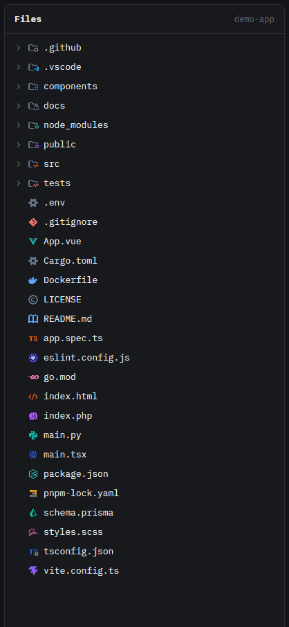

# Symbols Icons

A drop-in replacement for Herdr's Files panel that renders the tree with [Symbols](https://github.com/miguelsolorio/vscode-symbols), Miguel Solorio's minimal file icon theme for VS Code. Icons resolve the way VS Code resolves them and keep their original colors.



A mod for the [Herdr](https://herdr.dev) desktop app. It replaces the shipped `files` panel. Inspired by [herdr-file-icons](https://github.com/amster93/herdr-file-icons).

## What it does

- **317 icons** from Symbols, in full color.
- **Matched like VS Code:** by file name (`package.json`, `Dockerfile`), then the longest extension (`app.spec.ts` tries `spec.ts` before `ts`).
- **Named folders:** `src`, `components`, `.github`, `node_modules` and more get their own folder icon.
- Extensions Symbols only maps through VS Code language ids (`.php`, `.vue`, `.cs`, `.scss`…) are filled in by the generator.
- Everything else is Herdr's own Files panel: follows the focused pane's folder, git marks, live refresh, read-only preview.

## Install

1. Copy `mods/symbols-icons/` to `~/.config/herdr-app/mods/`.
2. Point your layout's Files block at it. Herdr's shipped layouts are read-only, so clone yours first:

   ```sh
   herdr-app do layout.clone '{"name":"main","as":"my-main"}'
   ```

   In `~/.config/herdr-app/layouts/my-main.json`, find the block with `"id": "files"` and change `"mod": "files"` to `"mod": "symbols-icons"`. Keep the id.
3. Check it:

   ```sh
   herdr-app check ~/.config/herdr-app/mods/symbols-icons
   ```

## Updating the icons

```sh
node tools/build-icons.mjs              # the pinned commit
node tools/build-icons.mjs main         # any git ref
```

Downloads the Symbols repo from GitHub and regenerates `mods/symbols-icons/icons/` and `icons.js`.

## Limitations

- Symbols has no open-folder or light-theme variants, so folders look the same open or closed.
- No language detection: icons are picked by name only.

## License

Code: Apache-2.0, see [LICENSE](LICENSE). Built from Herdr's shipped `files` mod. Icons: [Symbols](https://github.com/miguelsolorio/vscode-symbols), MIT, see [mods/symbols-icons/LICENSE-symbols.txt](mods/symbols-icons/LICENSE-symbols.txt). Chevrons: [Lucide](https://lucide.dev), ISC, see [mods/symbols-icons/LICENSE-Lucide.txt](mods/symbols-icons/LICENSE-Lucide.txt).
