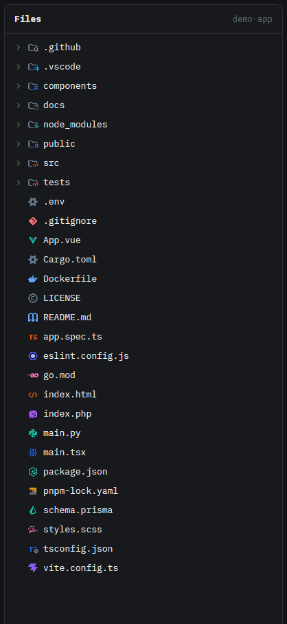

# Symbols Icons

A drop-in replacement for Herdr's Files panel that renders the tree with [Symbols](https://github.com/miguelsolorio/vscode-symbols), Miguel Solorio's minimal file icon theme for VS Code. Icons resolve the way VS Code resolves them (exact file name, then the longest matching extension, then language-id fallbacks) and keep their original colors, including badged folders like `src` and `.github`. It ships as a single panel for your existing layout, not a full layout.



This file is the brief: enough to build Symbols Icons from an empty folder. The files next to it are one build of it. If they don't work on your Herdr, or you want it different, build it again from here.

## What you see

- The same panel as Herdr's own Files panel, wherever your layout puts it (in Herdr's `main` layout: the right-hand panel, opened with the Files button in the tab bar). Theme background, 1px theme border, 10px rounded corners, 13px text.
- **Header**, 42px, 14px side padding, 1px bottom border: "Files" in semibold, and on the right in 12px dim text the folder's name. While a file is open: a `←` in the muted color on the left, and on the right the file's icon at 14px, 6px gap, then its path, truncated.
- **Tree**, 6px padding, rows 28px high with 7px rounded hover in the theme's hover color, 7px gap between the parts of a row:
  - 8px left padding plus 18px per level of nesting, 8px right padding;
  - a 12px chevron (right when closed, down when open) for folders, an empty 12px slot for files, tinted with the theme's dim color;
  - the item's **icon, 16px, in its own colors** (not tinted). Symbols icons are 24×24 outline/flat glyphs. Folders without a known name are a plain slate (`#64748B`) outlined folder; known folders are the same outline in a color with a small badge (`src` orange with `</>`, `tests` red with `</>`, `.github` with the Octocat, `node_modules` green with a node hexagon, `components` with blocks). Unknown files get Symbols' `document` icon;
  - the name, truncated with an ellipsis;
  - the git mark on the right in 11px: `A` (added or untracked) in ansi green (`ansi2`), `M` in the theme's `blocked` color, `D` and `U` in ansi red (`ansi1`).
- Folders come first, then files, each alphabetical. `.git` is never listed.
- An open file replaces the tree with a read-only code view: 12px in the terminal font, syntax colors from the theme's ansi colors (keywords `ansi5`, strings `ansi2`, comments dim, functions `ansi4`, types `ansi3`, numbers `ansi1`, constants `ansi6`). Files over 400,000 characters are cut with "… (file truncated)"; binary files say "Binary file · no text preview".
- Empty states in 12px dim text: "Loading files…", "No files", "No folder", or the error. Past the limits, in 11px: "File list limited to 500 entries per folder and 5,000 total".

## How it behaves

| Action | Result |
| --- | --- |
| Click a folder | Opens or closes it; the chevron turns, the folder icon stays the same (Symbols has no open-folder icons) |
| Click a file | Shows it in the panel, with its icon in the header |
| `←` | Back to the tree |
| Focus another pane | The panel follows that pane's folder (on its machine, for remote spaces); open folders and an open file are remembered per folder |
| Light theme | No change: Symbols has no light variants |

How an icon is chosen, the way VS Code does it with Symbols; names are compared in lower case:

1. **Folders:** the folder's name in the theme's `folderNames` table, exactly as listed (`src`, `.github`, `node_modules`). No normalisation: `.github` is listed with its dot, `github` alone is not. Otherwise `folder`.
2. **Files:** the file name in `fileNames` (`package.json`, `dockerfile`, `vite.config.ts`, `makefile`).
3. **Then the extension, longest first:** `app.spec.ts` tries `spec.ts` (Symbols' `ts-test`) before `ts`; `.env.local` tries `env.local`, then `local`.
4. Otherwise `document`.

The panel has no agent statuses. It refreshes every 10 seconds and whenever something in the folder changes (local spaces). No keys of its own, so there is no `keys.json`.

## Built from

- **One mod**, `mods/symbols-icons/`. Its `main.js` is a copy of Herdr's shipped `files` mod (the Files panel) with these changes:
  - imports `image` from gpui-kit and `ICONS` from `./icons.js`;
  - a `DIR = "mods/symbols-icons"` constant used for every asset path (the shipped chevrons point at `mods/files/`; change them to `${DIR}/`);
  - an `icon(path, dir)` function implementing the rules above and returning `${DIR}/icons/<id>.svg`;
  - each row draws `image(icon(path, entry.dir)).size(16)` in place of the shipped one-color `svg(... folder/file.svg).size(14).text_color(t.muted)`;
  - the header's right side becomes an `h_flex` (gap 6, `justify_end`) holding `image(icon(this.file, false)).size(14)` while a file is open, then the truncated path or folder name.
- `mod.json`: `{ "place": "none" }` (it only appears where a layout puts it).
- `chevron-down.svg`, `chevron-right.svg`: the shipped Lucide glyphs (ISC), drawn with `svg()` so they tint.
- `icons/`: 317 SVGs from **Symbols** (MIT), commit `2c95b15b0a8ef95ac62855e3784a6024ee6e5d2e` of https://github.com/miguelsolorio/vscode-symbols, each saved as `<icon id>.svg`, and its licence as `LICENSE-symbols.txt`.
- `icons.js`: `export default { file, folder, fileNames, fileExtensions, folderNames }`, every key in lower case, each value an icon id. About 36 KB.
- **The generator**, `tools/build-icons.mjs` at the repo root (Node 18+, no dependencies; uses `fetch` and `tar`). It downloads `https://codeload.github.com/miguelsolorio/vscode-symbols/tar.gz/<ref>`, reads `src/symbol-icon-theme.json`, lower-cases the tables, adds extensions and file names the theme only reaches through VS Code language ids (see Watch out), checks every id is defined, copies `src/<iconPath>` for every id the tables name to `icons/<id>.svg`, and writes `icons.js`. `node tools/build-icons.mjs <git ref>` moves to another version.
- **Your layout uses it** instead of `files`: in the block with `"id": "files"`, set `"content": { "mod": "symbols-icons" }`. Keep the block's id: the tab bar's Files button selects the block by id. Herdr's own layouts are read-only, so clone yours first:

  ```sh
  herdr-app do layout.clone '{"name":"main","as":"my-main"}'
  ```

- **`herdr` functions** (as the shipped mod): `spaces`, `panes`, `focused` for the folder; `exec` to list it (`sh`, or `powershell` on Windows) and for `git rev-parse` / `git status`; `watchFolder`, `readTextFile`, `theme`, `settings`, `window`. From gpui-kit: `View`, `div`, `svg`, `image`; from gpui-base: `v_flex`, `h_flex`, `Editor`, `EditorState`.
- It runs `sh`/`powershell` and `git` in the shown folder, like Herdr's own Files panel, and reads files there to preview them. No network at run time. Assets come only from its own folder. (The generator, run by hand, downloads from GitHub.)

## Watch out

- **Use `image()`, not `svg()`, for the icons.** `svg()` tints every path with the text color and the icons turn into grey silhouettes.
- **Language ids.** Symbols maps some common files only through `languageIds` (`php`, `vue`, `csharp`, `scss`, `haskell`, `makefile`, …), which a panel that only sees names can't use: `.php` and `.vue` have no `fileExtensions` entry. The generator carries a small hand-written table of language id → extensions (VS Code's defaults, e.g. `php: php phtml`, `csharp: cs csx`, `powershell: ps1 psm1 psd1`) and file names (`makefile`, `gnumakefile`, `dockerfile`, `containerfile`), resolves each through `languageIds`, and lets a real `fileExtensions`/`fileNames` entry win.
- **No open-folder or light icons.** Don't derive `-open` or `_light` ids; they don't exist in Symbols.
- **Folder names are exact.** Unlike Material Icon Theme, Symbols lists each folder spelling it wants (`.github`, `.vscode`); don't strip leading dots. `__tests__` and `github` have no entry and show the plain folder.
- **Pin a commit, not a tag.** The repo's tags stop at `0.0.9` while `package.json` is at `0.0.25`.
- **No path rules.** Symbols has no keys with a slash, so `.github/workflows/ci.yml` is the YAML icon.
- **Line endings.** On Windows with `core.autocrlf`, add `.gitattributes` with `* text=auto eol=lf` so the SVGs and `icons.js` aren't rewritten.
- Never edit the shipped `files` mod in place: on the next start Herdr moves an edited shipped mod to `files-edited` and restores its own. Start from a copy of the installed `mods/files/main.js` so the rest of the panel matches your Herdr version.
- The rows' limits come from the shipped panel: 500 entries per folder, 5,000 in total, 40 levels deep.
- `herdr-app check` writes `gpui-kit.d.ts` and `jsconfig.json` into the mod folder; they're not part of the mod.
- Follow the installed `herdr.d.ts` and `gpui-kit.d.ts`.

## Done when

- `herdr-app check mods/symbols-icons` passes with the matching Herdr binary and home.
- With your layout's Files block pointing at `symbols-icons`, the Files button shows the panel with colored icons: `main.py` the Python icon, `package.json` `node`, `.gitignore` `git`, `Dockerfile` `docker`, an unknown `x.foo` `document`.
- `src/` shows `folder-orange-code`, `.github/` `folder-github`, `node_modules/` `folder-node-modules`, an unknown folder `folder`; opening one turns the chevron and keeps the icon.
- `app.spec.ts` shows `ts-test`, not `ts`; `main.tsx` shows `react-ts`.
- `index.php` shows `php` and `App.vue` shows `vue` (from the language-id table).
- Clicking `vite.config.ts` shows the Vite icon and the path in the header, and the code below.
